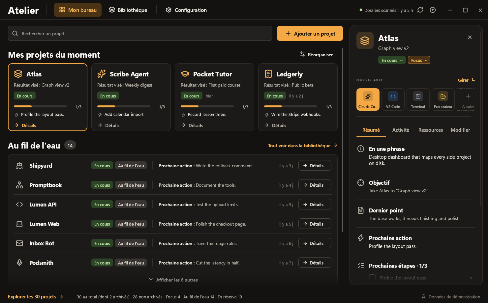
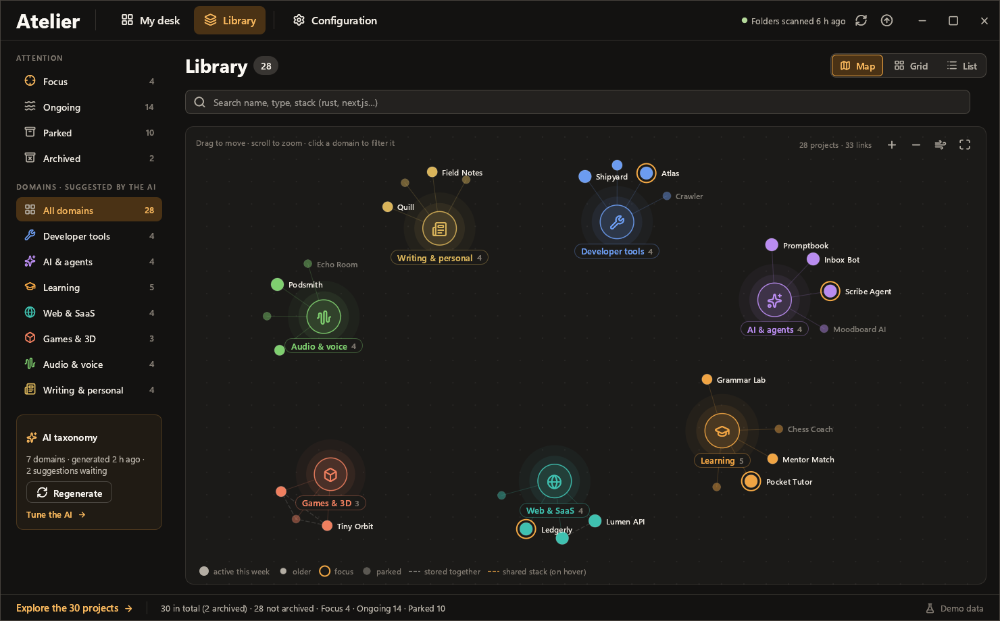

Atelier is a desktop app for Windows and Linux that keeps track of your side projects. It scans the folders you pick, recognizes the projects inside and puts them on a desk with their next steps, notes and launch buttons for VS Code, a terminal or Claude Code. It is written in Rust with egui.



## Features

- Folder scan up to three levels deep. Parts of a project such as `frontend`, `api` or `db` stay attached to their parent.
- Sorting and one sentence descriptions by a local model through Ollama, or by an AI agent through MCP.
- Fuzzy and semantic search.
- A library with a live graph of domains and projects.
- Updates from GitHub releases, checked at startup.



## Install

Download the file for your system from the [releases page](https://github.com/djdevpro/rustproject/releases), `atelier-<version>-windows-x64.exe` for Windows or `atelier-<version>-linux-x64` for Linux, and run it. On Linux, make it executable first with `chmod +x`. Atelier updates itself after that.

## Build

```bash
cargo run --release
```

Try it with 30 sample projects. Nothing gets saved.

```bash
cargo run -- --fixture fixtures/demo-en.json
```

## Connect an agent

```bash
claude mcp add atelier -- "C:\path\to\atelier.exe" --mcp
```

## Release

Open the Actions tab, run the Release workflow and pick patch, minor or major. The notes come from the commit messages since the last version, unless you type your own. Users see them in the update window.
