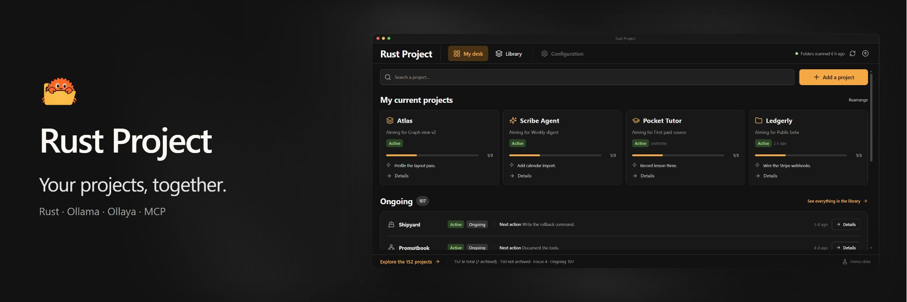
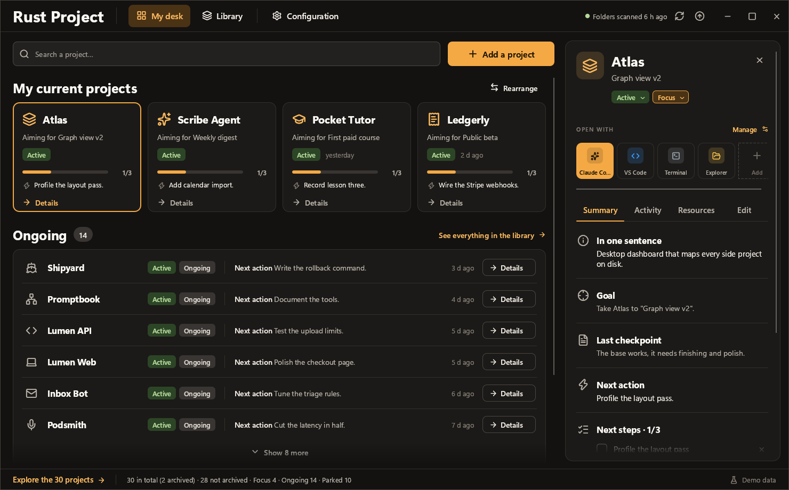
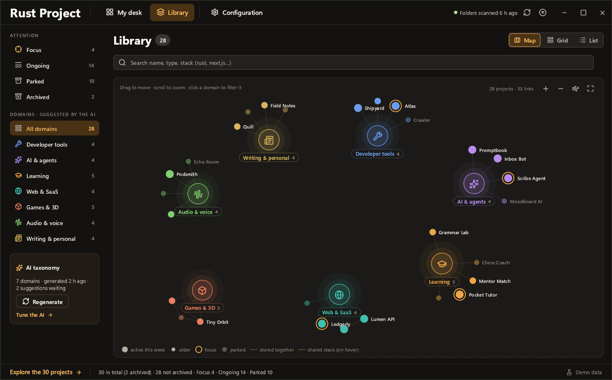
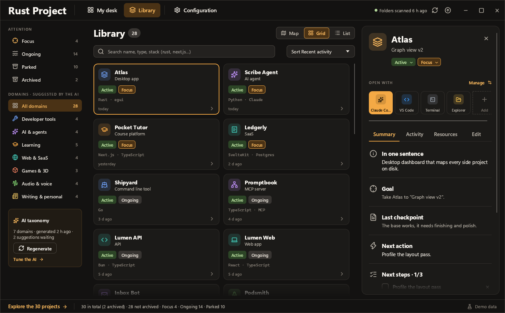

# Kit presse · Press kit

**Rust Project** est une application de bureau gratuite et open source. Elle retrouve les projets personnels éparpillés sur un ordinateur, les fait trier par une IA (locale ou agent), puis les range sur un bureau avec leurs prochaines étapes.

**Rust Project** is a free, open-source desktop app. It finds the side projects scattered across your computer, has an AI (local or agent) sort them, then lays them out on a desk with their next steps.

| | Français | English |
|---|---|---|
| Communiqué · Press release | [communique-fr.md](communique-fr.md) | [press-release-en.md](press-release-en.md) |
| Dossier de presse · Press kit | [dossier-de-presse-fr.md](dossier-de-presse-fr.md) | [press-kit-en.md](press-kit-en.md) |

## Visuels · Images

Libres d'utilisation pour illustrer un article sur Rust Project. Crédit : « Rust Project ».

Free to use to illustrate an article about Rust Project. Credit: "Rust Project".

| Bureau · Desk | Carte · Map | Grille · Grid |
|---|---|---|
|  |  |  |

Fichiers en pleine taille · Full-size files:

- [`banner.png`](../banner.png) (2000 × 667)
- [`bureau.png`](../bureau.png), [`carte.png`](../carte.png), [`grille.png`](../grille.png) (1480 × 920)
- Logo : [`icon.svg`](../../assets/icon.svg), [`icon.png`](../../assets/icon.png) (256 × 256)

## Essayer · Try it

- Téléchargements · Downloads: https://github.com/djdevpro/rustproject/releases
- Données de démonstration · Demo data: Configuration › Données › « Afficher les données de démonstration » · Configuration › Data › "Show the demo data"

## Contact

[Prénom Nom · First Last] · [e-mail]

Rust Project est un projet indépendant, sans lien avec la Rust Foundation ni avec le projet du langage Rust.

Rust Project is an independent project, not affiliated with the Rust Foundation or the Rust programming language project.
